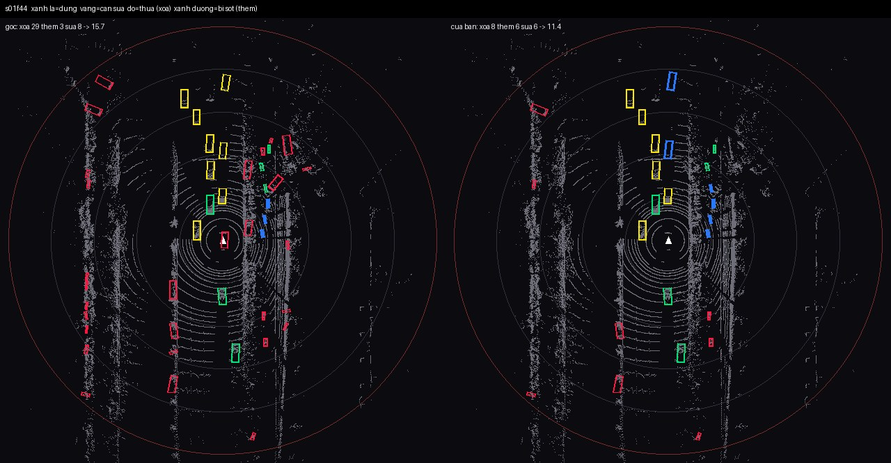

# Báo cáo Day 14 — Dương Quang Chung — 2A202603217

- Mã học viên dùng với `--student`: `217`
- `seed_tag` trong `frames_A.txt`: `393590736f`

## 1. Dự đoán trước sweep (bước 5b)

> Dự đoán được ghi trước khi chạy sweep và không sửa lại theo kết quả sweep.

- Tham số dự đoán giảm công sửa nhiều nhất: tăng `score_thr` từ `0.1` lên `0.4`; thử kết hợp `min_points=5` thay cho `0`.
- Lý do: cấu hình gốc trên ba frame cần xóa 72 box, thêm 5 và sửa 16. Đối chiếu camera cho thấy nhiều dự đoán thừa nằm trên cây, bụi hoa và hàng rào. Tăng ngưỡng tin cậy có thể loại bớt các dự đoán yếu; yêu cầu ít nhất 5 điểm trong hộp có thể loại thêm các hộp quá thưa điểm.
- Dự đoán: hai thay đổi trên có thể giảm chi phí tổng, nhưng chưa biết cấu hình nào tốt nhất. Thêm một box bị sót có trọng số `1.0`, còn xóa một box thừa chỉ có trọng số `0.3`, nên mất thêm một vật thật có thể xóa hết lợi ích của việc loại ba box thừa. Các vật xa, nhỏ hoặc bị che khuất có thể bị lọc nhầm. Vì vậy cần so sánh số xóa/thêm/sửa và leave-one-out sau sweep, không kết luận chỉ dựa vào số box giảm.
- Giới hạn của dự đoán: tập A chỉ có ba frame và sáu box khó xác nhận đã bị loại theo quyết định của tôi. Chi phí đo được phụ thuộc bộ tham chiếu này, không chứng minh cấu hình sẽ tốt trên mọi cảnh.

## 2. Tập A: sửa nhãn và tune

- Task CVAT: `D14-217-A` (task 28, job 28).
- Xuất nhãn bằng `scripts/vf_cvat.py reference`; chỉ có Shape, không có Track.
- `s01f44`: 17 box; `s03f41`: 7 box; `s04f47`: 10 box. Tổng 34 box.
- Tôi đã sửa các box trên CVAT, đối chiếu camera và LiDAR, xóa box thừa, chỉnh tâm/kích thước/đáy/hướng/lớp, đánh dấu che khuất và thêm box qua API CVAT. Sáu box LOW_VISIBILITY được xóa theo quyết định của tôi. Một số kích thước phần bị che được suy luận, không phải số đo chuẩn đã xác minh.
- Script hiển thị `scripts/cvat_lidar_display.js` chỉ hỗ trợ nhìn điểm, mặt đường tham chiếu và thao tác; các lệnh chỉnh nhãn API là bước riêng.

| Frame | Box tham chiếu | Xóa | Thêm | Sửa | Chi phí gốc |
|---|---:|---:|---:|---:|---:|
| s01f44 | 17 | 29 | 3 | 8 | 15.7 |
| s03f41 | 7 | 30 | 0 | 4 | 11.0 |
| s04f47 | 10 | 13 | 2 | 4 | 7.9 |

| Cấu hình | Xóa | Thêm | Sửa | Chi phí |
|---|---:|---:|---:|---:|
| Gốc (`score_thr=0.1`, `min_points=0`) | 72 | 5 | 16 | 34.6 |
| `best_config.json` (`score_thr=0.5`, `min_points=0`) | 10 | 11 | 12 | 20.0 |
| Dự đoán trước sweep (`score_thr=0.4`, `min_points=5`) | 27 | 9 | 13 | 23.6 |

- Tham số đã đổi trong `best_config.json`: `score_thr: 0.1 → 0.5`; các tham số khác giữ cấu hình gốc. `score_thr=0.5, min_points=5` đồng hạng 20.0; script lưu cấu hình `min_points=0` vì xuất hiện trước trong thứ tự thử.
- Kết quả leave-one-out từ script:

| Frame bỏ ra | Cấu hình chọn trên 2 frame còn lại | Chi phí trên frame bỏ ra | Oracle trong lưới |
|---|---|---:|---:|
| s01f44 | score_thr=0.5, min_points=0 | 11.4 | 11.4 |
| s03f41 | score_thr=0.5, min_points=0 | 3.8 | 3.8 |
| s04f47 | score_thr=0.5, min_points=0 | 4.8 | 4.8 |

- Số đo tự động: ba lượt đều chọn cùng cấu hình và đạt chi phí bằng oracle trong lưới đã thử. Điều này chỉ mô tả ba frame A, chưa đo khả năng tổng quát trên B.

- Cả ba lượt leave-one-out chọn 0.5/0; chi phí từng frame vẫn khác nhau (11.4, 3.8, 4.8). Tôi giữ cấu hình đã chọn trên A để đánh giá B, không tune lại theo B.

## 3. Trước/sau (bước 8)

- Số đo sweep: chi phí gốc 34.6; cấu hình chọn 20.0; mức giảm 42.2% trên tập A. Đây là chi phí theo công thức, không phải thời gian lao động. Cấu hình dự đoán 0.4/5 có chi phí 23.6, giảm 31.8%.
- So sánh định lượng cho thấy dự đoán tăng ngưỡng làm giảm chi phí trên A; cấu hình dự đoán 0.4/5 chưa tối ưu trong lưới. So với gốc, số xóa giảm 72 → 27, sửa giảm 16 → 13, nhưng thêm tăng 5 → 9. Cấu hình chọn 0.5/0 đạt chi phí thấp hơn (20.0), với xóa/thêm/sửa = 10/11/12.

## 4. Tập B

- Task CVAT `D14-217-B`: task/job 29, 12 frame. Sau khi tôi rà soát: 161 → 119 box; xóa 42 dự đoán thừa và 9 hộp LOW_VISIBILITY, thêm 9 vật thể, cập nhật 98 hộp có sẵn (bao gồm thay đổi ghi chú/cờ; không đồng nghĩa 98 lỗi hình học theo hàm chi phí). Không có Track.
- Dùng camera và LiDAR đối chiếu hộp; thêm Bus/Truck, người và xe hai bánh bị sót; sửa lớp/kích thước/đáy ở các trường hợp đủ căn cứ. Chi tiết trong `d14_217/review_B_audit.json`.
- Tôi đã xóa 9 hộp LOW_VISIBILITY: s03f21 (`pp_id` 9, 11); s05f05 (11, 13, 14, 16, 17); s05f31 (2, 13). Đây là quyết định loại hộp khó xác nhận, không chứng minh vật thể không tồn tại.

Số đo được xác nhận lại bằng lệnh chính thức `scripts/pp_prelabel.py --frames d14_217/frames_B.txt --config d14_217/best_config.json --gt d14_217/ref_B.json` (kèm `--data` trỏ tới Data-VF), sau khi xóa 9 hộp. Giữ cấu hình chọn từ A, không tune lại trên B. Log: `d14_217/cost_B_log.txt`.

| Xóa | Thêm | Sửa | Chi phí |
|---:|---:|---:|---:|
| 52 | 10 | 37 | 44.1 |

- Các lỗi đã ghi nhận: box nhầm cây/cột/biển báo, xe cao hoặc xe chở hàng bị gán Car, người và xe hai bánh bị sót. Các hộp bị che khuất cần kiểm lại vì kích thước phần khuất phải suy luận. Chi phí công thức không đo thời gian sửa từng loại.

## 5. Giới hạn

- Chỉ có ba frame A để tune; leave-one-out trên ba frame không đủ chứng minh tính tổng quát. Không dùng B để chọn lại cấu hình.
- Model huấn luyện trên KITTI khác miền dữ liệu VinFast; Truck/Bus và vật thể nhỏ/xa có thể bị nhầm hoặc sót.
- Chi phí là công thức trọng số, không phải thời gian sửa thực tế.
- Một số kích thước phần bị che trong nhãn A/B được suy luận; 9 hộp LOW_VISIBILITY ở B đã bị loại theo quyết định của tôi, có thể ảnh hưởng số đo bỏ sót/thừa. Kết quả phụ thuộc chất lượng nhãn tham chiếu, chưa phải đánh giá với ground truth độc lập.
